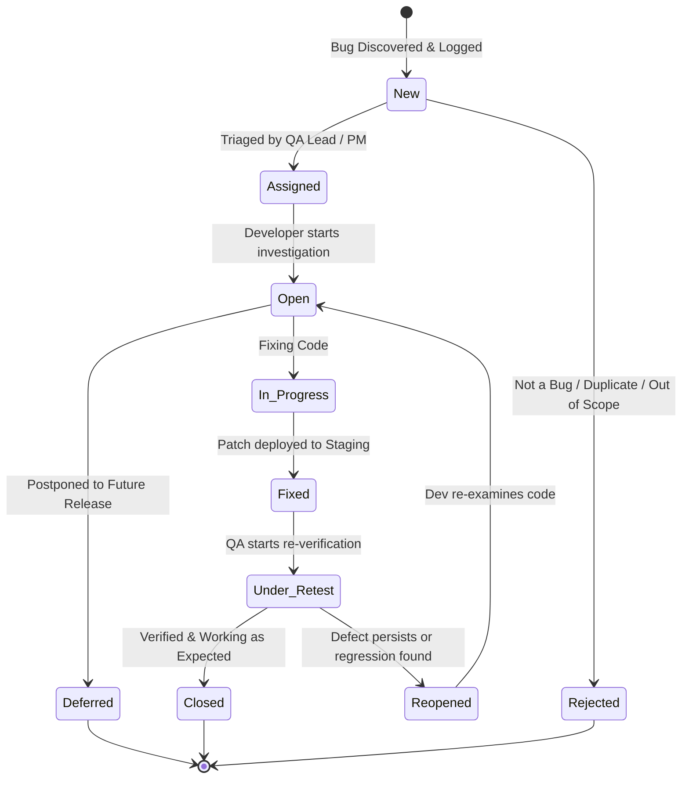

# Defect Management: Bug Life Cycle, Reporting Template & Sample Defects
**Document ID:** DEF-WEBPORTAL-2026-V1.0  
**Associated Test Plan:** TP-WEBPORTAL-2026-V1.0  
**Author:** QA Intern  
**Date:** October 2026  

---

## 1. Defect Life Cycle (Bug Life Cycle)

The Defect Life Cycle defines the systematic states a defect transitions through from discovery to closure.



### Defect States Explanation
1. **New:** When a defect is first identified and logged by the QA engineer.
2. **Assigned:** QA Lead or Project Manager reviews the defect and assigns it to the relevant development lead or engineer.
3. **Open:** Developer analyzes the defect, verifies the reproduction steps, and accepts the issue.
4. **Rejected / Not a Bug / Duplicate:** If the behavior matches PRD specifications, is a duplicate of an existing ticket, or cannot be reproduced.
5. **Deferred:** The bug is valid but prioritized for a subsequent release cycle due to low business impact or release deadlines.
6. **In Progress / Fixed:** Developer makes the code changes, writes unit tests, and deploys the build to the QA staging environment.
7. **Under Retest (Pending Verification):** QA tester re-runs the exact reproduction steps against the updated build.
8. **Reopened:** If the defect is still reproducible or introduced a regression, it is returned to the developer with updated test notes.
9. **Closed:** If the defect is completely resolved and verified across supported browsers, it is formally closed.

---

## 2. Standard Defect Report Template (Jira / Bugzilla Style)

Below is the standard industry template used to file production-grade bug reports:

```markdown
### [BUG-ID] Short, descriptive summary of the defect (Format: [Module] Issue description)

* **Reporter:** [Tester Name]
* **Assignee:** [Developer Name / Unassigned]
* **Date Logged:** [YYYY-MM-DD]
* **Environment:** Staging / Production (`https://staging-portal.example.com`)
* **Browser & OS:** [e.g., Chrome v128.0.6613.85 on Windows 11 Enterprise]
* **Build / Version:** [e.g., v1.4.2-staging-rc3]
* **Severity:** Critical (S1) | Major (S2) | Medium (S3) | Low (S4)
* **Priority:** Blocker (P1) | High (P2) | Medium (P3) | Low (P4)
* **Component / Module:** [e.g., Authentication / Entity Management]

#### Preconditions:
1. ...
2. ...

#### Steps to Reproduce:
1. Navigate to '...'
2. Enter '...' in field '...'
3. Click on '...' button
4. Observe ...

#### Test Data Used:
* Input values: ...

#### Expected Result:
* [Clear statement of what should happen according to specification]

#### Actual Result:
* [Clear statement of what actually happened, including error codes]

#### Visual Proof / Attachments:
* [Screenshots, Screen Recording GIF, Network HAR log, Console Error Log]

#### Workaround (if any):
* [Temporary alternative solution, if available]
```

---

## 3. Real-World Sample Defect Reports (From Staging Execution)

### Defect 1: Major CSV Export Character Encoding Bug

```markdown
### [BUG-001] [Export] CSV download corrupts special characters and accented text in record descriptions

* **Defect ID:** BUG-WEBPORTAL-001
* **Reporter:** QA Intern
* **Assignee:** Lead Backend Engineer
* **Date Logged:** 2026-10-23
* **Environment:** Staging (`https://staging-portal.example.com`)
* **Browser & OS:** Google Chrome v128 / Windows 11
* **Build / Version:** v1.0.4-rc1
* **Severity:** Major (S2)
* **Priority:** High (P2)
* **Component:** Data Export & Reporting

#### Preconditions:
1. User is logged in as an active portal user.
2. At least one entity record exists with accented characters or symbols in the title (e.g., "Résumé Audit – €500 / 25% discount").

#### Steps to Reproduce:
1. Navigate to `/portal/records/list`.
2. Locate record #104 containing text: "Résumé Audit – €500 / 25% discount".
3. Click the 'Export' button on the top right of the table.
4. Select 'Download CSV'.
5. Open the downloaded CSV file in Microsoft Excel or Notepad++.

#### Expected Result:
The exported CSV file should be encoded in UTF-8 with BOM (`utf-8-sig`) so that special characters like 'é', '–', and '€' display accurately without garbled characters.

#### Actual Result:
The exported CSV is encoded in ANSI / ASCII without UTF-8 BOM. Special characters render as corrupted symbols: "Résumé Audit €500".

#### Console / Log Details:
Backend response header: `Content-Type: text/csv; charset=ISO-8859-1` (Should be `charset=utf-8`).

#### Workaround:
Manual conversion of CSV character encoding via Notepad++ to UTF-8.
```

---

### Defect 2: Session Security - Inactive Session Modal Failure

```markdown
### [BUG-002] [Security] Inactivity timeout warning modal fails to appear before session termination

* **Defect ID:** BUG-WEBPORTAL-002
* **Reporter:** QA Intern
* **Assignee:** Frontend Lead
* **Date Logged:** 2026-10-23
* **Environment:** Staging
* **Browser & OS:** Mozilla Firefox v130 / Windows 11
* **Build / Version:** v1.0.4-rc1
* **Severity:** Medium (S3)
* **Priority:** Medium (P3)
* **Component:** Security & Session Management

#### Preconditions:
1. User is logged in and active on `/dashboard`.

#### Steps to Reproduce:
1. Leave the browser tab idle without mouse or keyboard inputs.
2. Wait for 14 minutes.
3. Observe the screen between 14:00 and 15:00 minutes.

#### Expected Result:
At 14:00 (60 seconds before session expiration), a modal dialog should pop up stating: "Your session will expire in 60 seconds. Do you want to stay logged in?" with 'Keep Logged In' and 'Log Out' buttons.

#### Actual Result:
No warning modal is displayed at 14:00. At 15:00, the user is abruptly kicked out to `/login?session=expired` without any prior prompt, resulting in unsaved form data loss.

#### Console Log:
`Uncaught TypeError: window.showTimeoutModal is not a function at timerWorker.js:42`
```

---

### Defect 3: Pagination Reset Bug on Page Size Change

```markdown
### [BUG-003] [CRUD] Changing page size from Page 3 does not reset active page index to 1

* **Defect ID:** BUG-WEBPORTAL-003
* **Reporter:** QA Intern
* **Assignee:** UI Developer
* **Date Logged:** 2026-10-23
* **Environment:** Staging
* **Browser & OS:** Apple Safari 17 / macOS Sonoma & Chrome 128 / Windows 11
* **Build / Version:** v1.0.4-rc1
* **Severity:** Medium (S3)
* **Priority:** Medium (P3)
* **Component:** Entity Management Table Pagination

#### Preconditions:
1. The database contains 45 total records.
2. Data table default page size is 10 rows per page (total 5 pages).

#### Steps to Reproduce:
1. Navigate to `/portal/records/list`.
2. Click pagination button '4' (showing records 31-40).
3. In the "Rows per page" dropdown, change the selection from '10' to '50'.

#### Expected Result:
When page size changes to 50, all 45 records fit onto 1 single page. The active page index should automatically reset to Page 1.

#### Actual Result:
The active page index remains set to Page 4 (`?page=4&limit=50`). The table displays "No records found" because Page 4 with limit 50 has zero records (records 151-200 do not exist).

#### Workaround:
User must manually click the '1' pagination button to see records again.
```
